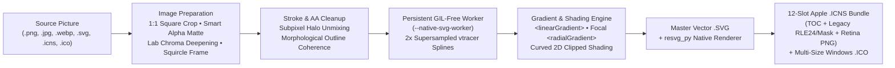

# Iconverter — Icon & Vector Studio

[](https://github.com/asteng88/Iconverter/releases/tag/v1.0.0)
[](https://www.python.org/)
[](./ModernTtk)
[](./LICENSE)

**Iconverter (Icon & Vector Studio)** is a high-precision desktop studio and command-line converter that transforms raster illustrations, logos, and photographs into **faithful scalable vector graphics (`.svg`)** and **complete 12-slot Apple icon bundles (`.icns`)** (plus multi-size Windows `.ico`).

Built on a hybrid vector-and-gradient reconstruction pipeline (`vtracer` + `resvg_py` + OpenCV + Pillow) and powered by **[ModernTtk](./ModernTtk)**, Iconverter reconstructs true SVG `<linearGradient>`, off-center focal `<radialGradient>`, and curved 2D smooth-shaded vector regions while eliminating subpixel anti-aliasing halo noise and staircase artifacts.

---

## Table of Contents

1. [Key Highlights](#1-key-highlights)
2. [Conversion & Studio Architecture](#2-conversion--studio-architecture)
3. [Complete 12-Slot Apple `.ICNS` Specification](#3-complete-12-slot-apple-icns-specification)
4. [Interactive Desktop Studio Guide](#4-interactive-desktop-studio-guide)
5. [Download & Installation](#5-download--installation)
6. [Command-Line Interface (CLI) Reference](#6-command-line-interface-cli-reference)
7. [Building Standalone `Iconverter.exe` with PyInstaller](#7-building-standalone-iconverterexe-with-pyinstaller)
8. [Auto-Updater & First-Run Initialization](#8-auto-updater--first-run-initialization)
9. [Project Structure & Running Tests](#9-project-structure--running-tests)
10. [License](#10-license)

---

## 1. Key Highlights

- **Faithful Vector `.SVG` Reconstruction**:
  - **2× Supersampled Spline Tracing**: Traces paths at 2× coordinate resolution via `vtracer` and normalizes them back into an exact source `viewBox` for subpixel contour accuracy.
  - **True SVG Gradients & Curved 2D Shading**: Automatically fits 1D `<linearGradient>`, off-center focal `<radialGradient>` (`fx`/`fy`), and `<clipPath>`-bounded 2D smooth-shaded layers for complex curved highlights, spherical buttons, and outer glows.
  - **Subpixel Anti-Aliasing & Line Cleanup**: De-blurs 1–2 px anti-aliasing color halos and applies morphological stroke coherence so dark outlines and thin specular highlights stay crisp at `200%` and `400%` zoom.
- **Complete 12-Slot Apple `.ICNS` Encoder**:
  - Writes every standard macOS icon slot from `16×16 @1x` (`is32`/`s8mk` + `icp4`) through `512×512 @2x Retina` (`1024×1024` `ic10`) with a binary `TOC ` table of contents.
  - Includes a verified PackBits `RLE24` encoder with an exact `3 * W * H` decoded-length guard so legacy macOS and `PIL.IcnsImagePlugin` readers decode every slot cleanly.
- **Interactive Desktop Studio (`ModernTtk`)**:
  - **Non-Destructive Side-by-Side Comparison**: The left **Original Picture** panel always displays your untouched original image, while all edits, framing, and live previews happen on the right **Rendered Vector .SVG** and **ICNS Multi-Size Inspector** panels.
  - **1:1 Square Crop with Locked Equal-Side Handles**: Frame any square region using 8 interactive handles (`NW`, `N`, `NE`, `E`, `SE`, `S`, `SW`, `W`) that strictly maintain equal side lengths (`1:1`) and discard everything outside the square.
  - **Smart Transparency Matte & Colour Picker**: Flood-fill background extraction, CIE Lab chroma separation deepening, and click-to-sample colour chips for removing interior background pockets or glows.
  - **5-Level Undo (`Ctrl+Z`)**: Instant 5-step undo stack in both the header and action footer with cached preview restoration.
  - **Native Vector Zoom (`Fit`, `100%`, `200%`, `400%`)**: Re-rasterizes the `.svg` directly via `resvg_py` at the target zoom resolution rather than upscaling a bitmap.
- **Uninterrupted 30 FPS Animated Chronograph Timer**:
  - Displays a 36-frame subpixel-anti-aliased frosted glassmorphic chronograph medallion + live `"1.2s • 65%"` pill over active output canvases while previews update.
  - Offloads GIL-holding native Rust extensions (`vtracer`, `resvg_py`) to a persistent `--native-svg-worker` child process (`ModernSubprocessWorker`) and glides progress smoothly between stage ceilings—eliminating mid-trace UI freezes.
- **Seamless In-Place GitHub Auto-Updater**:
  - Checks [GitHub Releases](https://github.com/asteng88/Iconverter/releases) on startup and via the **Updates** button, verifies `Content-Length` and `SHA-256` checksums over HTTPS, and updates `Iconverter.exe` in-place on disk while preserving your `icons/` folder.

---

## 2. Conversion & Studio Architecture



---

## 3. Complete 12-Slot Apple `.ICNS` Specification

Every exported `.icns` file begins with an `icns` magic header and a `TOC ` (Table of Contents) chunk followed by up to 12 verified icon slots (14 chunks including legacy 8-bit alpha masks):

| Slot OSType | Mask OSType | Pixel Dimensions | macOS Display Slot | Encoding Format |
| :--- | :--- | :--- | :--- | :--- |
| `is32` | `s8mk` | `16 × 16` | `16x16 @1x` (Legacy Finder) | PackBits `RLE24` RGB + 8-bit Alpha Mask |
| `icp4` | — | `16 × 16` | `16x16 @1x` | RGBA PNG |
| `ic11` | — | `32 × 32` | `16x16 @2x Retina` | RGBA PNG |
| `il32` | `l8mk` | `32 × 32` | `32x32 @1x` (Legacy Finder) | PackBits `RLE24` RGB + 8-bit Alpha Mask |
| `icp5` | — | `32 × 32` | `32x32 @1x` | RGBA PNG |
| `ih32` | `h8mk` | `48 × 48` | `48x48 @1x` (Legacy Finder) | PackBits `RLE24` RGB + 8-bit Alpha Mask |
| `ic12` | — | `64 × 64` | `32x32 @2x Retina` | RGBA PNG |
| `icp6` | — | `64 × 64` | `64x64 @1x` | RGBA PNG |
| `ic07` | — | `128 × 128` | `128x128 @1x` | RGBA PNG |
| `ic13` | — | `256 × 256` | `128x128 @2x Retina` | RGBA PNG |
| `ic08` | — | `256 × 256` | `256x256 @1x` | RGBA PNG |
| `ic14` | — | `512 × 512` | `256x256 @2x Retina` | RGBA PNG |
| `ic09` | — | `512 × 512` | `512x512 @1x` | RGBA PNG |
| `ic10` | — | `1024 × 1024` | `512x512 @2x Retina` | RGBA PNG |

---

## 4. Interactive Desktop Studio Guide

| Studio Control | Description |
| :--- | :--- |
| **Source & Output Card** | Open any `.png`, `.jpg`, `.jpeg`, `.webp`, `.bmp`, `.tiff`, `.gif`, `.ico`, `.svg`, or `.icns` file, paste from the clipboard, or click **Load Studio Icon (`Icon_generator.icns`)**. Select the output folder (defaults to `./icons`) and output formats (`.svg`, `.icns`, `.ico`). |
| **Framing & Transparency Card** | Choose between **Faithful Original (Keep Canvas)**, **Transparent (Smart Alpha Matte)**, or **macOS Squircle Badge**. Toggle **Edge-Safe JPEG Artifact Denoise**, **Auto-Trim**, and **Deepen Color Differences** (`0–100`). |
| **1:1 Square Crop** | Click **Square Crop** to display the interactive 1:1 square frame on the right preview canvas. Drag any corner (`NW`, `NE`, `SE`, `SW`) or edge (`N`, `E`, `S`, `W`) handle to resize with locked equal side lengths, or drag inside the square to reposition. Press **Apply Crop** (or `Enter`) to crop, or **Reset Crop** to restore full dimensions. |
| **Pick Transparency Colour** | Click **Pick Colour** (or the toolbar eyedropper button) and click any background or glow pixel on the canvas to add it to the transparency matte. Click any colour chip swatch to remove that pick. |
| **SVG Vector Fidelity Card** | Select from **Ultra Faithful (Recommended)**, **High Detail Illustration**, **Balanced Vector**, or **Compact Clean Logo** presets. Customize **True SVG Gradients**, **Clean Anti-Aliased Lines**, **Color Precision** (`3–8`), **Layer Difference** (`1–32`), and **Speckle Filter** (`0–16`). |
| **Undo (`Ctrl+Z`)** | Click **Undo** in the top header or bottom action bar (or press `Ctrl+Z`) to step back through up to 5 previous editor states instantaneously. |

---

## 5. Download & Installation

### Option A: Standalone Windows Executable (No Python Required)
1. Download **[`Iconverter.exe`](https://github.com/asteng88/Iconverter/releases/latest/download/Iconverter.exe)** (or **[`Iconverter_v1.0.0.zip`](https://github.com/asteng88/Iconverter/releases/latest/download/Iconverter_v1.0.0.zip)**) from the [Latest GitHub Release](https://github.com/asteng88/Iconverter/releases/latest).
2. Run `Iconverter.exe`. On first run, it automatically creates an `icons/` folder next to the executable and seeds it with the studio icons.

### Option B: Run from Source (`uv` or `pip`)

```powershell
git clone https://github.com/asteng88/Iconverter.git
cd Iconverter
uv sync
```

Launch the desktop studio:
```powershell
uv run python icon_converter.py
# or double-click / run:
.\Iconverter.bat
```

---

## 6. Command-Line Interface (CLI) Reference

Iconverter includes a full headless CLI for batch scripts and CI workflows:

```powershell
# Convert an image to both .svg and 12-slot .icns using the Ultra Faithful preset
uv run python icon_converter.py --cli icons\Icon_generator.icns --out-dir icons --name studio_copy

# Convert with Smart Alpha Matte, Lab chroma deepening, transparency seed picks, and Windows .ico
uv run python icon_converter.py --cli input.jpg --out-dir icons --name app_icon `
    --bg-mode transparent --deepen-strength 60 --pick 12,12 --ico

# Crop a 1:1 square region (x,y,size) and frame as a macOS Squircle Badge
uv run python icon_converter.py --cli avatar.png --out-dir icons --name avatar_squircle `
    --crop-square 40,20,256 --bg-mode squircle
```

### CLI Options

| Flag | Description |
| :--- | :--- |
| `--version` | Print `Iconverter v1.0.0` and exit. |
| `--cli INPUT` | Run headless conversion on `INPUT` and exit. |
| `--out-dir DIR` | Output folder (defaults to `INPUT`'s directory in CLI mode). |
| `--name STEM` | Base filename stem for generated `.svg` / `.icns` / `.ico` files. |
| `--bg-mode {faithful,transparent,squircle}` | Background framing mode (default: `faithful`). |
| `--preset {ultra,high,balanced,compact}` | Vector tracing fidelity preset (default: `ultra`). |
| `--crop-square X,Y,SIZE` | Crop a 1:1 square region before conversion (`X,Y,SIZE` or `X0,Y0,X1,Y1`). |
| `--pick X,Y` | Add a smart transparency seed coordinate (pixel or normalized `0..1`, repeatable). |
| `--deepen-strength 0..100` | CIE Lab chroma separation depth for smart transparency (default: `55.0`). |
| `--no-deepen-diff` | Disable Lab chroma separation deepening. |
| `--trim` / `--padding PCT` | Auto-trim uniform outer margins with optional padding percentage (default: `6.0`). |
| `--no-gradients` | Disable true SVG gradient reconstruction. |
| `--no-line-cleanup` | Disable subpixel anti-aliasing deblurring and stroke line cleanup. |
| `--no-denoise` | Disable edge-safe JPEG artifact cleanup. |
| `--no-sharpen` | Disable small-icon crispness boost (`<= 128 px`). |
| `--no-svg` / `--no-icns` | Skip writing `.svg` or `.icns` output. |
| `--ico` | Also export a multi-resolution Windows `.ico` file (`16×16` to `256×256`). |
| `--theme THEME` | Initial `ModernTtk` theme name for GUI mode (default: `fluent_dark`). |

---

## 7. Building Standalone `Iconverter.exe` with PyInstaller

To compile a single-file Windows executable with bundled `Icon_generator` icons and native `vtracer` / `resvg_py` binaries:

```powershell
uv run pyinstaller --clean --noconfirm --onefile --windowed --name Iconverter ^
    --icon icons/Icon_generator.ico --add-data "icons;icons" ^
    --paths ModernTtk --collect-all vtracer --collect-all resvg_py icon_converter.py
```

The standalone executable is output to `dist\Iconverter.exe`.

---

## 8. Auto-Updater & First-Run Initialization

1. **First-Run `icons/` Folder Creation (`ensure_icons_dir()`)**:
   - Every time `Iconverter` starts, it ensures `<app_dir>/icons` exists (`Path(sys.executable).parent / "icons"` when frozen, or `./icons` in source mode) and seeds `Icon_generator.icns`, `Icon_generator.svg`, and `Icon_generator.ico` if missing.
2. **GitHub Releases Check & In-Place Executable Replacement**:
   - Queries `https://api.github.com/repos/asteng88/Iconverter/releases/latest` (or `ICONVERTER_UPDATE_URL`).
   - Streams the new `.exe` to a temporary `.tmp_download` file over HTTPS and verifies both `Content-Length` and GitHub's `sha256` asset digest before moving it into place.
   - Performs atomic NTFS in-place replacement (`Iconverter.exe` -> `Iconverter.exe.old`, `update_<ver>.exe` -> `Iconverter.exe`) and spawns an invisible background VBS cleaner to remove `.exe.old` after the app closes.

---

## 9. Project Structure & Running Tests

```text
Iconverter/
├── icon_converter.py        # Core conversion engine, 12-slot ICNS encoder, updater & ModernTtk GUI
├── ModernTtk/               # Hybrid Fluent & Bootstrap Tkinter/ttk UI library (with 30 FPS ActivityTimer)
│   ├── modernttk/
│   │   ├── __init__.py
│   │   ├── icons.py         # 28 procedural 4x supersampled vector icons
│   │   ├── style.py         # ThemeManager & OS dark/light auto-detection
│   │   ├── themes.py        # 10 built-in color palettes
│   │   ├── utils.py         # 4x supersampled Pillow shape renderers
│   │   └── widgets/
│   │       ├── timer.py     # ActivityTimer, BusyOverlay, SubprocessWorker & TaskRunner
│   │       └── ...          # Buttons, Cards, Inputs, Notebook, DataTable, ProgressDialog, etc.
│   ├── demo.py              # Interactive 5-page ModernTtk showcase gallery
│   └── instructions.md      # Complete ModernTtk developer documentation
├── tests/
│   └── test_icon_converter.py # Comprehensive 21-test suite (vector PSNR, ICNS RLE24, GUI & updater)
├── Iconverter.bat           # One-click Windows launcher
├── pyproject.toml           # PEP 621 project metadata & dependencies
├── CHANGELOG.md             # Release history
├── CONTRIBUTING.md          # Developer setup & contribution guide
├── SECURITY.md              # Auto-updater verification & security policy
└── LICENSE                  # MIT License
```

Run the full test suite with `pytest`:

```powershell
uv run pytest -v
```

---

## 10. License

Released under the **[MIT License](./LICENSE)**. Copyright © 2026 Andrew Thomas (`asteng88`).
